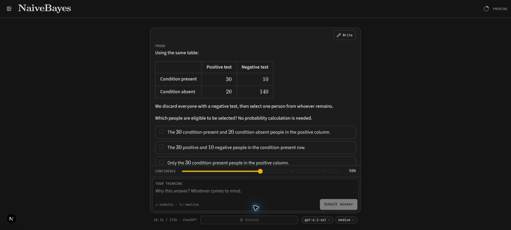
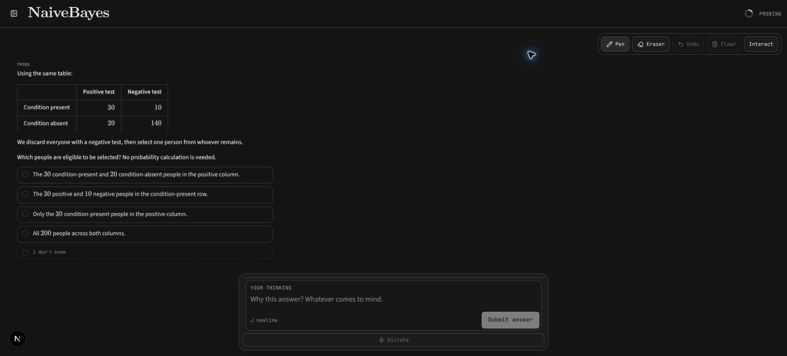
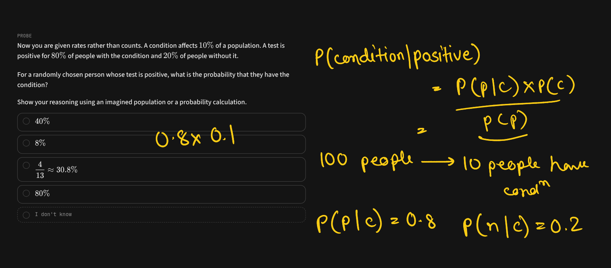
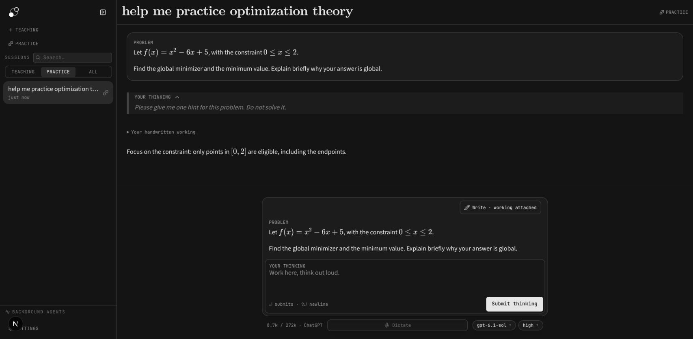
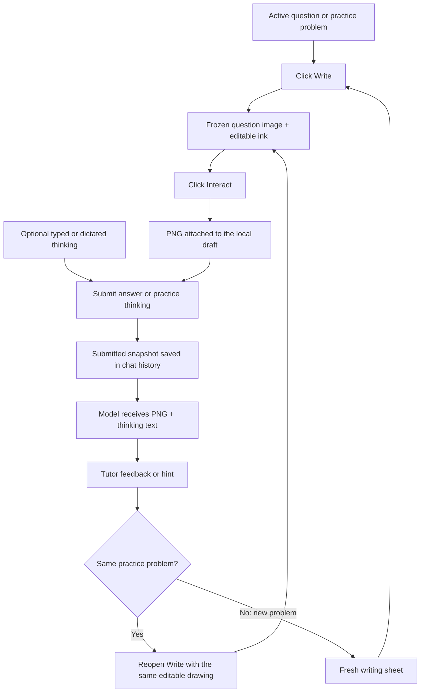

# Handwriting test branch

This branch adds a pen-tablet writing surface to teaching questions and practice problems. You can work through a problem by hand, keep the thinking box available, and send the working to the tutor as an image. It is shared for hands-on testing and feedback, without a merge request.

The branch contains handwriting, its supporting image/history handling, and tests. It does not include the author's personal local-dictation or Linux setup changes.

## Run it

Use a separate checkout so you can try this without changing an existing installation. The project uses Node.js 26 in CI and release builds; see the [development guide](development.md) for the full setup.

```bash
git clone --branch codex/handwriting-contribution --single-branch https://github.com/hrdkj/learnharness.git learnharness-handwriting
cd learnharness-handwriting
npm ci
npm run dev -- --hostname 127.0.0.1 --port 3001
```

Open [http://localhost:3001](http://localhost:3001). Configure your provider/connection and models in Settings. The conversation model must support images to receive handwritten working. No special tablet integration or personal dictation service is required by this branch.

## Use Write and Interact

1. Start a teaching or practice session and wait for an active question/problem.
2. Click **Write** at the top right of the question dock. The app captures the complete question onto a frozen writing sheet, with space around it for working.
3. Draw with your pen. The **Your thinking** box stays available below the sheet; you can type there or use the app's existing dictation if configured.
4. Use **Pen**, **Eraser**, **Undo**, or **Clear** as needed. Erasing removes whole strokes, and Undo can restore them. A recognized pen-eraser button temporarily selects erasing while held.
5. Click **Interact** to return to the normal question controls. If there is visible ink, your current working becomes an attached PNG in the draft; an empty or fully erased sheet attaches no image. This step does not submit it to the tutor.
6. In teaching, select or enter your answer and submit it with the working. In practice, **Submit thinking** accepts handwriting alone, text alone, or both.
7. In practice, ask for a hint or send an intermediate step. If the same problem stays active, click **Write** again to continue editing the same drawing. A new problem starts with a fresh sheet.

Enter makes a newline in the thinking box while Write is open. Return to Interact to submit. Escape returns to Interact when dictation is idle; if dictation is active, Escape cancels it first. Ctrl/Cmd+Z undoes ink when the drawing surface owns the keyboard, and normal text undo remains available in the thinking box.

### The Write button

The entry point is the **Write** button at the top right of an active question. Teaching still has its usual answer controls; handwriting accompanies the answer.



### The writing surface

The question stays fixed while the ink is edited. Drawing controls are at the top right, and the live thinking box remains below the sheet. **Interact** returns to the answer controls.



### Real tablet working saved with an answer

This is an actual submitted image from the author's XP-Pen Star 03 V2 session. It shows the learner's working, not a worked-solution answer key. The question and yellow handwriting are in the image; the live thinking box and toolbar are not. The tutor can inspect the intermediate reasoning, including mistakes.



### Continuing after a hint

This live practice check requested a hint without solving or replacing the problem. The same problem remains active, **Write · working attached** is still available, and the submitted image appears under **Your handwritten working**. Reopening Write preserved the test ink and its Undo history. The check used a small test mark rather than a complete handwritten solution.



## How it works

The browser keeps two layers: a frozen image of the question and a separate ink canvas. It also keeps the stroke history in memory so you can undo and continue drawing. On Interact, it combines the question and visible ink into a PNG. Typed or dictated thinking stays separate as text.

On submission, that PNG is saved with the conversation and delivered as image content to the selected model. This feature does not perform a separate handwriting-to-text/OCR step: the model reads the image itself. The app needs a model that accepts images; a text-only model produces an error instead of accepting an image it cannot read.



The frozen background is reused when reopening a drawing with ink. It is not continuously recaptured as feedback arrives. Toolbar controls and the live thinking box are excluded from the submitted PNG.

## What is saved?

| Action | Editable drawing | Submitted history |
|---|---|---|
| Write → Interact → Write | Retained for the current question/problem | No submission yet |
| Submit practice working, then receive a hint on the same problem | Retained and editable | A separate image snapshot is saved for that submission |
| Add more ink and submit again | Continues from the current drawing | Earlier snapshots remain unchanged |
| Clear the drawing | Removes current draft ink | Earlier submissions stay in history |
| Move to a new problem | Starts fresh | Earlier submissions stay in history |
| Reload or leave/reopen the chat | Editable strokes are not restored | Submitted images remain viewable in history |
| Server rejects a send | Draft is retained | The rejected attempt is not shown as a saved submission |

**Interact is not durable autosave.** Editable strokes and unsent working live in memory. The PNG becomes part of the saved conversation when its submission is accepted. Restored images are viewable snapshots, not editable stroke files.

## Tablet compatibility and current limits

The author's tablet is an **XP-Pen Star 03 V2**, used with Linux and Chrome. The recipient's tablet model is not yet known, and other physical tablet setups have not been verified.

A smaller physical tablet is not rejected by this implementation: the app maps browser pointer coordinates onto the writing canvas rather than checking a tablet's physical dimensions. We expect basic drawing to work when the tablet/driver/browser supplies normal pen or mouse pointer input. That is an expectation from the implementation, not a guarantee for every tablet.

- **Pressure and hover:** pen contact uses positive pressure; zero-pressure pen movement is treated as hover. Mouse-style input uses a fixed width. A driver that reports contact as zero-pressure pen input may need configuration or investigation.
- **Stylus buttons:** held erasing recognizes the standard eraser signal (`buttons & 32`). A generic right-click/barrel button uses a different signal and is not automatically treated as erasing. Use the on-screen Eraser if the driver's side-button mapping differs.
- **Touch:** finger/touch drawing is intentionally ignored. A pen reported as a touch pointer will not draw.
- **Screen versus tablet size:** a smaller tablet changes the hand movement needed for a given pointer movement. A smaller app window is a separate issue: long questions are scaled to fit the sheet and may become small. This version has no writing-sheet zoom/pan controls.
- **Erasing:** the eraser removes complete strokes rather than rubbing out parts of a line.

The browser's pressure and eraser/barrel button conventions are defined in the [W3C Pointer Events specification](https://www.w3.org/TR/pointerevents3/). Actual driver/browser behavior still needs a hardware check.

## What to try and report in Discord

Try basic writing, pen lift/hover, pressure variation, toolbar erasing, stylus-button erasing, Undo, and Clear. Then try Write → Interact → Write several times, send handwriting without text in practice, request a hint, continue on the same drawing, and verify that a new problem starts fresh. Finally, reload and open **Your handwritten working** in history.

Include the tablet model, operating system, browser, driver/button mapping if known, and a short description of what happened. In particular, feedback on comfort and accuracy with a smaller tablet would be useful. Use the existing Discord conversation for feedback.

## Verification

Automated coverage includes pen contact/hover and eraser gestures, keyboard handling, image validation and model delivery, snapshot persistence/history, failed sends, problem changes during dictation completion, and collapse/reopen lifecycle handling. The browser regression also exercises repeated table/math captures, image-only practice sends, same-problem ink retention, fresh problems, and history reload.

```bash
npm run typecheck
npm run lint
npm run build
node scripts/smoke-question-writing.mjs
```

For the full deterministic test suite, use an isolated profile as described in the development guide. Browser regressions use scripted tutor responses and real canvas pixels; those checks do not certify every physical tablet or model's handwriting accuracy.
